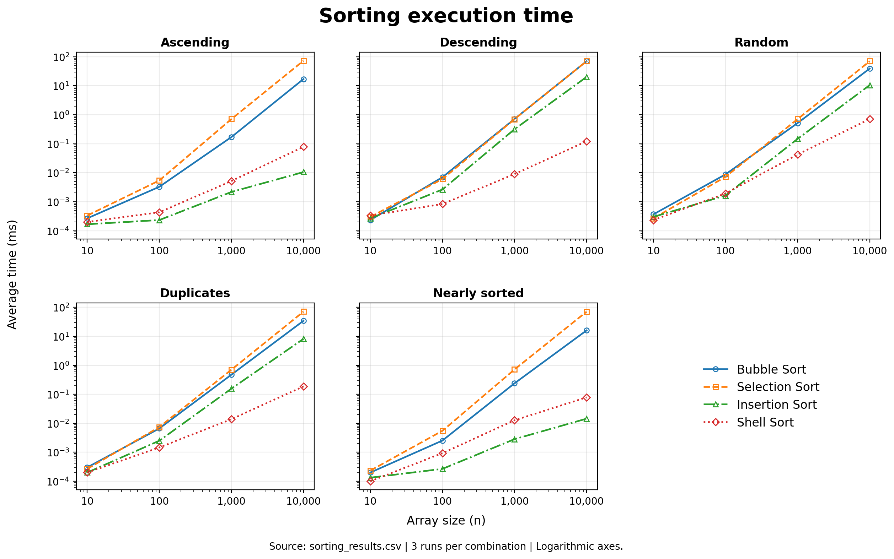
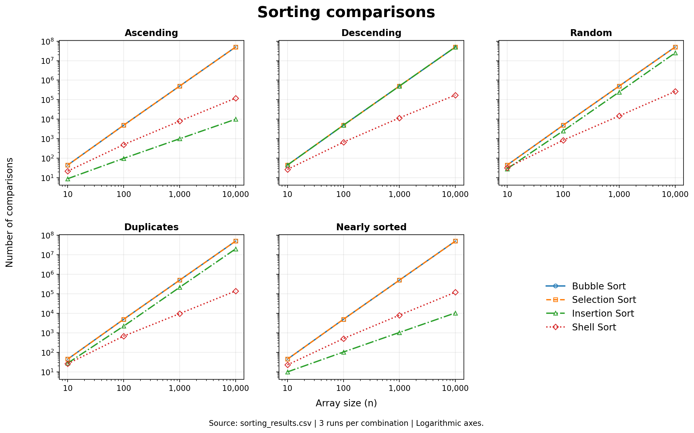
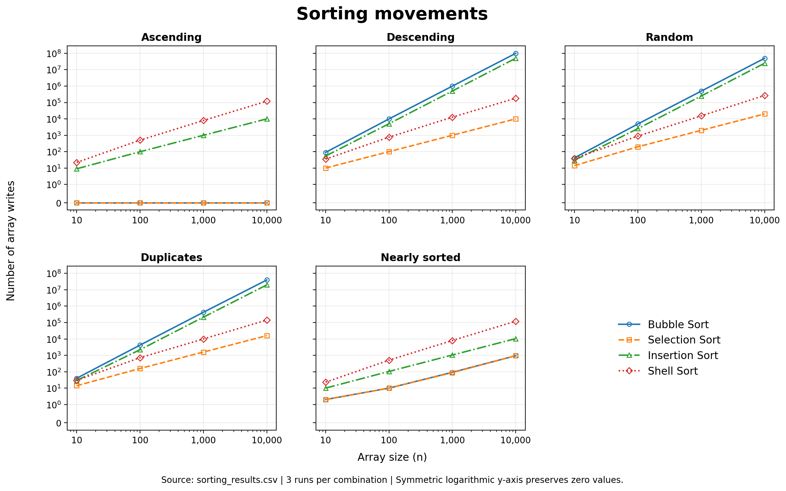

# Algorithm Analysis

## Universidad Central del Ecuador

**Faculty:** Engineering and Applied Sciences
**Degree:** Information Systems Engineering
**Subject:** Algorithms
**Project:** Integrative Group Task - Weeks 3, 4 and 5 - Part II

## Project Description

This project implements and analyzes different algorithms in Java to understand computational complexity, iteration, recursion and sorting techniques.

The program measures execution time, comparisons and movements to evaluate the performance of each algorithm through practical experiments.

## Objectives

- Implement algorithms with different computational complexities.
- Compare iterative and recursive solutions.
- Implement sorting algorithms manually.
- Measure execution time and operation counts.
- Analyze algorithm performance using different input sizes and data distributions.

## Technologies

- Java 27
- IntelliJ IDEA
- Apache Maven
- Git
- GitHub

## Project Structure

```text
AlgorithmAnalysis/
├── src/main/java/ec/edu/uce/algorithms/
│   ├── ComplexityAnalysis.java
│   ├── Iteration.java
│   ├── Recursion.java
│   ├── Sorting.java
│   ├── Benchmark.java
│   └── Main.java
├── Results/
│   ├── boards/
│   │   └── sorting_results.csv
│   ├── charts/
│   │   ├── comparisons.png
│   │   ├── execution_time.png
│   │   └── movements.png
│   └── captures/
│       ├── Execution output images
│       ├── execution_log.txt
│       └── README.txt
├── pom.xml
├── .gitignore
└── README.md
```

## Activity 1 - Complexity Analysis

Three algorithms were implemented to analyze computational complexity.

| Algorithm | Complexity |
|---|---|
| Linear sum | O(n) |
| Quadratic comparison | O(n²) |
| Logarithmic division | O(log n) |

The theoretical and experimental operation counts were compared using different input sizes.

All experimental operation counts matched the theoretical results.

## Activity 2 - Iteration and Recursion

Iterative and recursive methods were implemented for the following operations:

- Factorial calculation.
- Array sum.
- Array maximum.

Both approaches were evaluated using operation counts, execution times and special cases.

### Results

| Operation | Iterative | Recursive |
|---|---:|---:|
| Factorial of 5 | 120 | 120 |
| Array sum | 30 | 30 |
| Array maximum | 10 | 10 |

## Activity 3 - Sorting Algorithms

Four sorting algorithms were implemented manually without using built-in sorting methods.

- Bubble Sort
- Selection Sort
- Insertion Sort
- Shell Sort

### Sorting Results

Original array:

```text
[45, 12, 90, 12, 3, 70, 45, 18]
```

Sorted array:

```text
[3, 12, 12, 18, 45, 45, 70, 90]
```

| Algorithm | Comparisons | Movements |
|---|---:|---:|
| Bubble Sort | 28 | 28 |
| Selection Sort | 28 | 8 |
| Insertion Sort | 19 | 21 |
| Shell Sort | 22 | 24 |

All sorting algorithms passed the implemented tests.

## Activity 4 - Experimental Analysis

The sorting algorithms were evaluated using different input sizes and data distributions.

### Input Sizes

- 10 elements
- 100 elements
- 1000 elements
- 10000 elements

### Data Distributions

- Ascending
- Descending
- Random
- Duplicates
- Nearly sorted

### Experimental Configuration

| Parameter | Value |
|---|---|
| Sorting algorithms | 4 |
| Input sizes | 4 |
| Data distributions | 5 |
| Repetitions per test | 3 |
| Total executions | 240 |
| Total records | 80 |
| Operating system | Windows 11 |
| Architecture | amd64 |
| Available processors | 16 |
| Java version | 27.0.1.0.3 |

Execution times were measured using System.nanoTime().

Each algorithm received a copy of the same original array to ensure a fair comparison.

The movement counter represents array writes. A swap counts as two movements.

## Experimental Results

The experimental results are available in the following CSV file:

[Sorting Results](Results/boards/sorting_results.csv)

### Execution Time



### Comparisons



### Movements



## Execution Evidence

The execution output and reconstructed console images are available in:

[Execution Evidence](Results/captures/08_final_execution.png)

[Original Execution Log](Results/captures/execution_log.txt)

The reconstructed images are based on actual program output and are not original IDE screenshots.

The CSV file and charts correspond to the preserved benchmark run. The execution log corresponds to a subsequent run, so execution times may differ.

## How to Run

1. Open the project in IntelliJ IDEA.
2. Configure Java 27 as the project SDK.
3. Load the Maven project.
4. Open Main.java.
5. Run the main method.
6. Review the results in the console.

The experimental results are automatically exported to Results/boards/sorting_results.csv.

Running the program again overwrites the CSV file with new experimental results.

## Project Status

- [x] Complexity analysis
- [x] Iterative algorithms
- [x] Recursive algorithms
- [x] Sorting algorithms
- [x] Input validation
- [x] Experimental analysis
- [x] CSV export
- [x] Experimental charts
- [x] Execution evidence
- [x] Project documentation

## Academic Purpose

This project was developed for educational purposes as part of the Algorithms course at Universidad Central del Ecuador.

## Interactive Presentation

The project includes an interactive web presentation that explains:

- Algorithmic complexity.
- Iteration and recursion.
- Sorting algorithm visualizations.
- Experimental performance comparisons.
- Analysis of benchmark results.

To open the presentation, launch `presentation/index.html` in any modern web browser.

The presentation uses HTML, CSS, and JavaScript to simulate the algorithms implemented in Java. No additional dependencies or server configuration are required.
